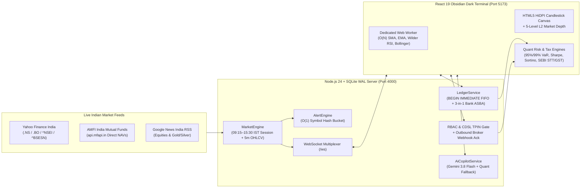

# KitePulse — Real-Time Indian Stock Market, MCX Commodities & Multi-Broker Portfolio Tracker

An end-to-end TypeScript financial portfolio tracker, 3-in-1 bank/Demat ledger, and quantitative risk terminal engineered with **zero black-box wrapper frameworks**. Built for real-time NSE/BSE/MCX/AMFI market tracking, ACID FIFO tax-lot accounting, RBAC + CDSL TPIN external broker imports with outbound webhook notifications, off-main-thread Web Worker technical indicators, SEBI statutory contract notes, and parametric Value at Risk (VaR) analytics.

---

## 1. System Architecture (Phases 1 – 4)



---

## 2. Core Engineering Pillars Across All 4 Phases

| Phase | Module | Key Engineering Implementation |
| :--- | :--- | :--- |
| **Phase 1: Core ACID Ledger & Indicators** | [`src/server/db.ts`](src/server/db.ts), [`src/server/ledgerService.ts`](src/server/ledgerService.ts), [`src/shared/indicators.ts`](src/shared/indicators.ts) | Native `node:sqlite` in `WAL` mode (`BEGIN IMMEDIATE`), `UNIQUE` idempotency keys, $O(K)$ chronological FIFO tax-lot consumption, $O(1)$ hash-bucket price alerts, and $O(N)$ SMA/EMA/Wilder RSI(14)/Bollinger Bands inside a browser Web Worker. |
| **Phase 2: Live NSE/BSE/AMFI & 3-in-1 Bank Rail** | [`src/server/marketEngine.ts`](src/server/marketEngine.ts), [`src/shared/catalog.ts`](src/shared/catalog.ts) | Live Yahoo Finance India (`.NS`/`.BO`) & AMFI (`api.mfapi.in`) quote + 5m OHLCV sync, `09:15–15:30 IST` market session engine, universal NSE/BSE symbol lookup, and atomic double-entry 3-in-1 Bank ↔ Demat UPI/IMPS/ASBA transfers (`SBI`, `HDFC`, `ICICI`). |
| **Phase 3: SEBI Contract Note, Tax Harvesting & Commodities** | [`src/shared/indianTaxAndCharges.ts`](src/shared/indianTaxAndCharges.ts) | MCX Gold/Silver & commodity equities (`GOLDBEES`, `SILVERBEES`, `MCX GOLD 10G`, `MCX SILVER 1KG`, `TITAN`, `VEDL`, `HINDALCO`, `TATASTEEL`), exact SEBI statutory contract note (`STT/CTT`, `Exchange Turnover`, `SEBI Fee`, `Stamp Duty`, `18% GST`, `CDSL DP ₹15.93`), Section 111A STCG (20%) / Section 112A LTCG (12.5%) tax-loss harvesting, 5-level L2 Market Depth ladder, and live market news feed. |
| **Phase 4: Obsidian Dark UI, RBAC Broker Import & Quant VaR** | [`src/shared/quantRiskEngine.ts`](src/shared/quantRiskEngine.ts), [`src/server/index.ts`](src/server/index.ts), [`src/client/App.tsx`](src/client/App.tsx) | High-contrast Obsidian Dark Mode (`#070B12` / `#0D1421`) with natural `Inter` (`tabular-nums`) typography, zero-preset raw data lock, RBAC (`OWNER_ADMIN`, `PORTFOLIO_IMPORTER`, `AUDITOR_READ_ONLY`) + CDSL 16-digit BOID/TPIN/OTP broker import verification with outbound broker webhook notifications (`BROKER_NOTIFIED_200_OK`), and Parametric 95%/99% 1-Day & 10-Day Basel III VaR, Sharpe Ratio, Sortino Ratio, and HHI Concentration metrics. |

---

## 3. Quick Start & Verification

```bash
# 1. Install dependencies
npm install

# 2. Run all 8 automated unit & integration tests (Phase 1 – Phase 4)
npm test

# 3. Verify production TypeScript & Vite bundle
npm run build

# 4. Start the Backend Server (Port 4000) and Vite React Client (Port 5173)
npm run dev:server
npm run dev:client
```
