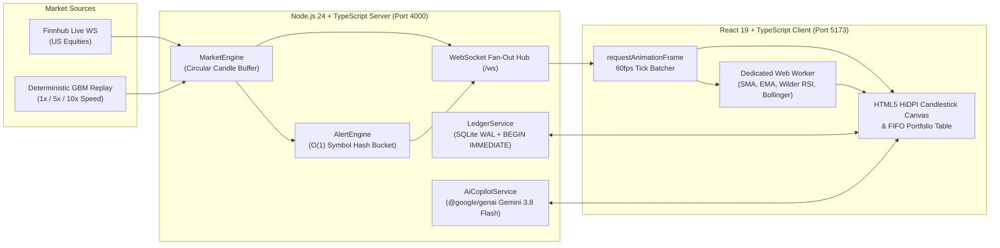

# KINETIC // Real-Time Stock Portfolio Tracker & Quant Terminal

An end-to-end TypeScript financial portfolio tracker and paper-trading terminal engineered with **zero black-box wrapper frameworks**. Designed to demonstrate real-time WebSocket fan-out networking, ACID double-entry/FIFO tax-lot accounting, off-main-thread Web Worker technical analysis, $O(1)$ stream alert evaluation, and structured-JSON AI portfolio risk analysis.

---

## 1. System Architecture



---

## 2. Core Engineering Pillars

| Pillar | Implementation File | Key Engineering Concept |
| :--- | :--- | :--- |
| **1. WebSocket Fan-Out & Market Replay** | [`src/server/marketEngine.ts`](src/server/marketEngine.ts) | Single upstream Finnhub WebSocket connection + Mulberry32/Box-Muller Geometric Brownian Motion replay engine (`1x`, `5x`, `10x` speed) so live ticks stream 24/7 including weekends. |
| **2. ACID Paper Trading & FIFO Ledger** | [`src/server/ledgerService.ts`](src/server/ledgerService.ts) | Native `node:sqlite` in `WAL` mode using `BEGIN IMMEDIATE` write-locked transactions, `idempotency_key` deduplication, and strict chronological FIFO (`ORDER BY acquired_at ASC, id ASC`) tax-lot consumption. |
| **3. Off-Main-Thread Technical Indicators** | [`src/shared/indicators.ts`](src/shared/indicators.ts) & [`src/client/workers/indicators.worker.ts`](src/client/workers/indicators.worker.ts) | $O(N)$ sliding-window **SMA (20/50)**, **EMA (12/26)**, **14-Period Wilder's RSI**, and **Bollinger Bands (20, 2σ)** computed inside a browser Web Worker + `requestAnimationFrame` UI batching. |
| **4. $O(1)$ Real-Time Price Alert Engine** | [`src/server/alertEngine.ts`](src/server/alertEngine.ts) | Symbol-keyed in-memory `Map<string, PriceAlert[]>` evaluates every incoming tick in $O(1)$ lookup time without polling the database. |
| **5. Direct Gemini AI Risk Copilot** | [`src/server/aiCopilot.ts`](src/server/aiCopilot.ts) | Uses `@google/genai` (`gemini-3.8-flash`) with strict JSON schema output grounded in FIFO ledger weights and asset betas, paired with a deterministic quantitative fallback engine. |

---

## 3. Environment Variables

Copy `.env.example` to `.env` (optional—the application runs out-of-the-box with zero API keys using the built-in Deterministic Market Replay & Quant Stress-Test engines):

| Variable | Required | Default | Description |
| :--- | :--- | :--- | :--- |
| `PORT` | No | `4000` | Backend HTTP & WebSocket server port |
| `FINNHUB_API_KEY` | No | *(Empty)* | Optional Finnhub API key for live US market trade WebSockets |
| `GEMINI_API_KEY` | No | *(Empty)* | Optional Google Gemini API key for live `gemini-3.8-flash` risk synthesis |
| `SQLITE_DB_PATH` | No | `./data/portfolio.sqlite` | Path to local SQLite WAL database file |

---

## 4. Quick Start & Verification

```bash
# 1. Install dependencies
npm install

# 2. Run automated unit & integration tests (FIFO ledger, idempotency, RSI/BB math, O(1) alerts)
npm test

# 3. Start the Backend Server (Port 4000) and Vite React Client (Port 5173)
npm run dev:server
npm run dev:client
```
